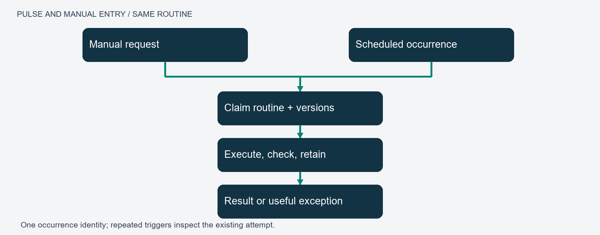
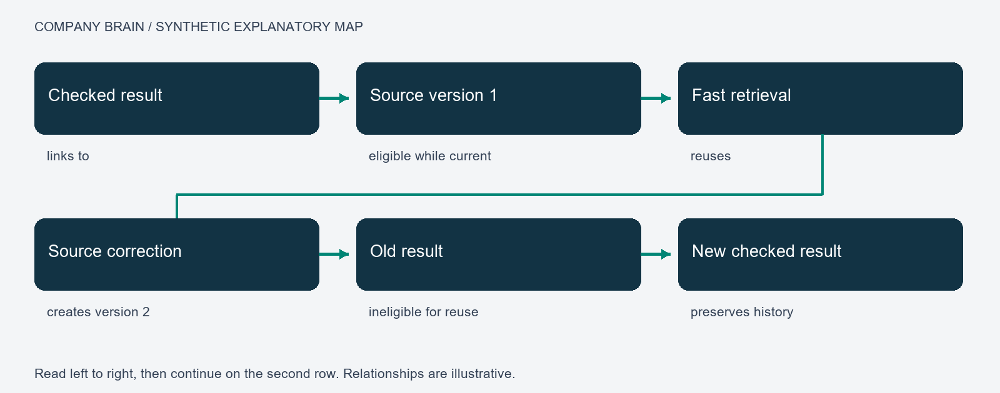

# Company Brain: Illustrated Annexes and Adoption Guide

Alexandru Rada · 11 October 2026 · Companion to Company Brain and The Architecture of Consent

## Annex A. Reading the map

Figure A1. Synthetic explanation of the relationships represented in MAPS. The arrows have different meanings: an objective governs a task; a skill guides it; a tool performs an operation; a check evaluates an artifact; a retained result supplies evidence for later retrieval. None of these arrows means that the connected records are equally authoritative.

Use these relationship types explicitly: governs, requires, uses, produced, checked-by, derived-from and supersedes. Each link should resolve to an identified record and, for an execution, its bound version. A current map is a view of those records. Historical maps remain useful for reconstructing a past decision but should not silently govern current work.

The actual overview in the main paper illustrates the whole network. A selected path is more useful for explaining a task than hundreds of unlabelled edges. Public diagrams here contain invented example labels rather than a dump of operational memory. They explain the design without granting access to a private workspace.

## Annex B. Prompt, procedure and tool interaction

Public teaching example, newly written for this guide: “Prepare a weekly equipment summary from the approved inspection records. Include unresolved faults and link each statement to its source.” This example contains no operational prompt from the author's system.

The intake identifies the desired summary, the equipment project, the reporting interval, the approved source set and the expected format. If the interval is unknown, the executor obtains it instead of inventing dates. The original request remains authoritative; interpreting an abbreviated request does not authorise extra actions.

A task contract might state: read the approved synthetic inspection records; write one summary; include every unresolved fault; attach source identities; do not modify the inspections or contact suppliers. The reporting skill supplies a procedure: retrieve eligible records, reconcile versions, group findings, draft, check coverage and save the result. A tool performs the actual read or write. A validator compares the summary with the requested coverage and current records.

The prompt helps interpret and compose. The runtime enforces allowed operations and tracks execution. The skill provides reusable task knowledge. The evaluator tests the result. These responsibilities remain distinguishable even if one program hosts them all. Avoid placing credentials or permission enforcement inside prose.

The human result is the summary, its sources, unresolved limitations and any decision needed. Intermediate tool traffic belongs in the audit record. An unavailable inspection source should appear as a coverage gap, not as a fabricated finding.

## Annex C. Pulses and routines

Figure C1. A scheduled occurrence and a manual request enter the same bounded routine. The trigger is separate from the procedure and from the worker that performs it. A saved receipt provides evidence of the attempt; acceptance establishes the scope of completion.

For a weekly report, the scheduler creates one occurrence identity for the project, routine and reporting period. The worker claims it using a version check. It binds the skill and sources, performs the steps and retains the result. Repeated delivery of the same occurrence retrieves the existing state rather than starting another report. Different periods create different occurrences.

An uncertain external effect enters reconciliation. For example, a provider may accept a render request before the client loses its connection. The next action is to inspect the original provider request, not submit a second render. A provider without reconciliation support limits the assurance the system can offer.

A pulse can maintain links, prepare a briefing, review new research or propose a skill revision. Each has its own output and acceptance. Use an existing review routine when it already covers the purpose; do not create several timers that repair the same files concurrently. Record missed occurrences and define catch-up behaviour explicitly.

Test passive operation with a real nonempty occurrence: leave the host available, let the scheduler initiate it, verify the resulting artifact and notification, then repeat the trigger to test deduplication. Test an interrupted attempt separately. A manually completed example or an empty queue check is not evidence for the full scheduled path.

## Annex D. Memory, correction and skill development

Figure D1. A checked result becomes retrievable evidence. A correction creates a new source version and makes affected old results ineligible for current reuse. Historical records remain available for explanation and rollback.

Use a minimal record with identity, project, type, version, status, source references and a concise content field. Keep substantial product documents in their own workspace; the memory record stores their location, purpose and evidence relationship. Distinguish saving an artifact from accepting its claims.

A candidate skill should name the repeated problem, the procedure, prerequisites, actual tools, expected outputs, failure conditions and test cases. Its predecessor remains recoverable. Test the candidate on development cases and the failures that motivated it. Use separate held-out cases to assess transfer. A case used to fix the skill is no longer untouched evaluation evidence.

Example: a source changes a measurement from metres to millimetres. The old derived summary must not be reused merely because its text still appears relevant. Bind units and source versions; invalidate dependants; regenerate and check the affected output. The included synthetic fixture demonstrates version invalidation and artifact-integrity checks, not language-model understanding of units.

## Annex E. Harnesses, roles and accountable handoffs

A harness makes the task boundary explicit: inputs, permitted effects, dependencies, budgets, checkpoints and completion tests. It should be as small as the task allows. A deterministic transformation does not need an executive debate. A consequential interpretation may need a specialist and an evaluator with different evidence or methods.

An executive defines the outcome and acceptable trade-offs. A coordinator divides work and checks prerequisites. A specialist returns an artifact and evidence. A reviewer checks the stated criteria. The same executor may perform several roles when separation would add cost without improving checks; record that fact rather than presenting self-review as independent review.

Each handoff carries a task identity, source versions, output reference and status. The receiver checks that prerequisites are satisfied. Preserve unresolved disagreement. A majority of model responses is not a truth criterion, especially when they share sources or failure modes.

Long-running work needs a durable checkpoint describing completed steps, artifacts, outstanding actions and uncertain effects. Resume from the checkpoint after verifying current dependencies. A prose summary alone should not decide whether an external action must be repeated.

## Annex F. Adaptations since the initial thesis

The early formulation centred on accepted work becoming durable knowledge and reusable skills. Subsequent design work clarified the following responsibilities. This is a conceptual synthesis, not a declaration that every proposed feature is production-complete.

- MAPS: memory navigation, execution, recurring triggers and human views share identifiable records.
- ARMS: applications, routines, memory and skills offer a complementary packaging view over the same contracts; they do not require another authoritative store.
- Native-chat use: an ordinary conversation can initiate the same scoped work that a dashboard initiates. Host integration must be explicitly implemented; local instructions do not establish universal interception.
- Two-layer retrieval: a qualified known result can be reused; changed dependencies return work to deliberation.
- Research intake: retrieve accessible source material, distinguish inspected evidence from gaps, compare it with current needs and preserve a connected summary.
- Work lessons: retain reproduced failures, the actual correction, regression evidence and limits. A proposed prompt change remains distinct from a verified fix.
- Role-specific harnesses: bind actual tools, scope and domain checks at dispatch rather than treating a role name as a running agent.
- Task traces: correlate request, response, artifact and validation across dependencies. Correlation is evidence integrity, not semantic proof.
- Executive review: identify priorities and candidate connections without automatically promoting speculation to approved work.
- Human interface: expose understandable results, meaningful exceptions and navigable evidence; keep raw operational machinery out of ordinary reading.
- OS boundary: maintain the control layer independently of product documents, creative assets and external project repositories.

## Annex G. Implementation sequence for adopters

### 1. Choose a small outcome

Select a reversible task with accessible evidence, such as a report from synthetic records. Define who owns it, where output belongs and what a correct result contains. Write three ordinary success cases and three plausible failures before selecting an orchestration framework.

### 2. Establish current knowledge

Assign identities and versions to the sources. Record project scope and candidate/accepted/superseded status. Implement a current-record query and a history view. Confirm that changing a source invalidates an affected derived result without erasing its history.

### 3. Build one execution path

Represent a task as queued, running, waiting, completed or failed, with explicit allowed transitions. Use transactional ownership to prevent two workers from claiming it. Bind procedure and source versions. Save actual outputs and receipts. Never infer completion solely from a worker's final sentence.

### 4. Add the selected model and tools

Start with deterministic operations. Add model interpretation where needed, supplying bounded context and a clear output contract. Verify the actual connector, account scope and tool schema. A discovery catalog is a lead, not evidence of access. Keep credentials in the platform's credential facility.

### 5. Add checks and recovery

Check task-specific content as well as file existence. Inject a missing source, stale write, damaged artifact and interrupted attempt. Preserve original operation identity when the outcome is uncertain. Test restore from the selected authoritative store and retained artifacts.

### 6. Add recurring initiation

Have the scheduler submit the same task specification as manual initiation. Give each occurrence a stable identity and define catch-up, time zone, cancellation and retry behaviour. Verify a real scheduled artifact before claiming unattended operation.

### 7. Add improvement and a map

Retain useful outcomes; propose versioned skill changes; compare them with the existing procedure. Display the actual relationships and current status. Ask a reader to locate a result, understand a failure and correct a rule. Measure whether the interface supports those actions.

### 8. Scale only against requirements

A local transactional service may be enough initially. Distributed workers require leases or equivalent ownership, durable waits, idempotent effects and cross-process recovery. Evaluate candidate frameworks against the same failure fixtures. A framework name is not an acceptance test.

## Annex H. What would make the contribution scholarly?

State one answerable research question: does scoped procedural memory improve accepted work over the same system with factual memory alone? Define the claimed contribution relative to retrieval, experiential agents and existing workflow systems. The proposed integration may be useful without every individual mechanism being novel.

For an empirical paper, publish a task set and protocol, compare appropriate baselines, hold major conditions constant, report uncertainty and failures, and evaluate unseen task families. Ablate source-version checks, procedural memory and evaluation separately. Measure false completion and stale reuse alongside success and cost. An impressive graph, a count of skills or a large regression suite is not a substitute for those comparisons.

For a conceptual contribution, define the terms and causal links, state assumptions, address competing explanations and derive propositions that could be challenged. The consent thesis should distinguish local influence, procedural propagation and institutional effects; evidence for one level does not automatically establish the next.

For a systems contribution, specify the contracts and threat/failure model, release a reproducible non-sensitive artifact, evaluate recovery and usability, and explain trade-offs. A public teaching fixture establishes only its stated mechanical behaviours. Independent reproduction and real task evaluation would strengthen the work.

## Annex I. Public demonstration

Run `python examples/demo.py` from this repository. It requires Python 3.10 or newer and uses only the standard library. All records are invented. It makes no network calls, reads no private data and writes no external files. Tests check current retrieval, stale-source rejection, project isolation, candidate exclusion and artifact tampering. It is an educational fragment; production requires persistent transactions, ownership, authenticated tools and substantive evaluators.

## Annex J. Reading and discussion

Read the main thesis for the argument and the consent paper for the authority question. Use the diagrams to follow one task. Reproduce the teaching tests, then try a counterexample in an isolated environment. Useful contributions include a failed assumption, an alternative design with a measured trade-off, an independently reproduced result or a clearer evaluation task.

Public references: https://arxiv.org/abs/2409.07429 ; https://arxiv.org/abs/2303.11366v4 ; https://www.w3.org/TR/prov-overview/ ; https://opentelemetry.io/docs/concepts/context-propagation/ . These sources inform the design; no endorsement by their authors is implied.
